# Харчування: меню та нарахування

Система Sadok має гнучкий модуль обліку та інформування батьків про харчування в закладі. Три типи меню: інформаційне, з вибором страв та комплексних варіантів меню батьками. Також окремо є можливість налаштувати нарахування за кожен прийом їжі чи день згідно відвідуваності.
Детальніше про кожен тип меню далі.

:::info Хто налаштовує?
Всі меню та формат обліку нарахувань здійснюється **адміністратором** закладу.
:::

**Обовʼязкові налаштування для всіх** типів меню та форматів обліку нарахувань:

Додаємо реквізити до розділу харчування:

- Профіль - Налаштування - Харчування - **Способи оплати** - Обираємо зі списку доступних шаблонів реквізитів - Додати.

Вказуємо авансовий платіж (за потреби):

- Профіль - Налаштування - Харчування - В полі "**Аванс харчування**" вказуємо суму (наприклад, 2000) - Зберегти.

Інші налашутвання вже обираємо згідно формату інформування та надання вибору батькам...

## Меню без вибору для батьків (інформаційне)

:::warning Єдине на заклад
Інформаційне меню одне на весь заклад, без можливості внесення окремих меню для різних груп.
:::

Дане меню має виключно ознайомчий формат. На головній сторінці батьків відображається меню на день, для перегляду на інші дні тижня необхідно натиснути "Переглянути меню".

**Інструкція налаштування інформаційного меню:**

Крок 1. Встановлюємо основні параметри системи. 

- Профіль закладу > Налаштування > Харчування > **"Меню без вибору страв"** > Зберегти.

Приклад: 

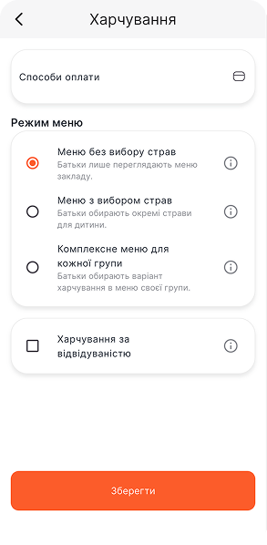

Крок 2. Вносимо прийоми їжі, страви та формуємо розклад меню на кожен день.

- Профіль закладу > Харчування > **Прийоми** > "+" > Додаємо назву прийому іжі (наприклад, "Сніданок") > В полі "Ціна, грн" залишаємо 0, якщо не будемо нараховувати по прийомам їжі згідно відвідуваності > Порядковий номер присвоюється автоматично.
- Профіль закладу > Харчування > **Страви** > "+" > Додаємо назву страви (наприклад, "Сирники") > Заповнюємо іншу інформацію по страві (за потреби) > Додати.
- Профіль закладу > Харчування > **Меню** > На дні тижня натискаємо "+"та додаємо прийоми з попередньо внесених в розділ "Прийоми" > Додати.
- Профіль закладу > Харчування > Меню > **День тижня** > "+" на прийомі їжі > Додаємо страви із списку > Зберегти.

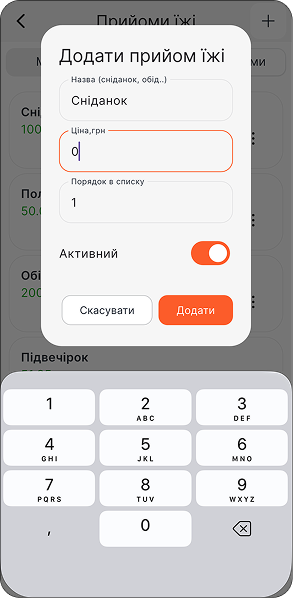 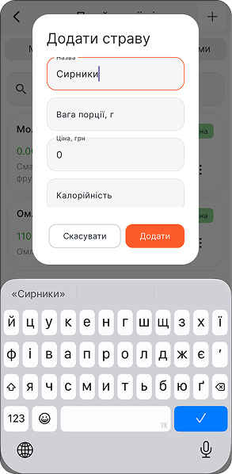 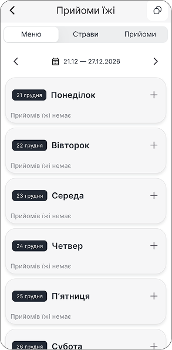 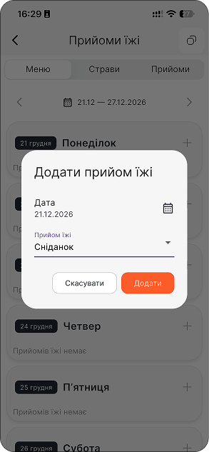 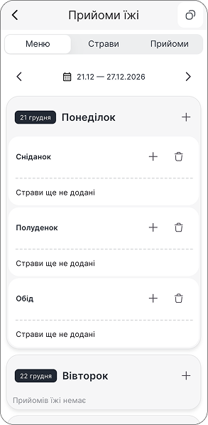 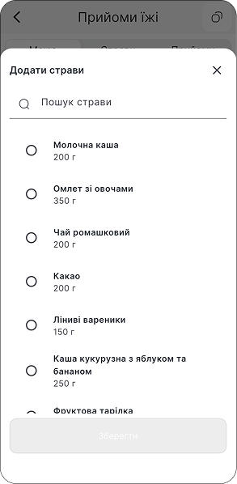 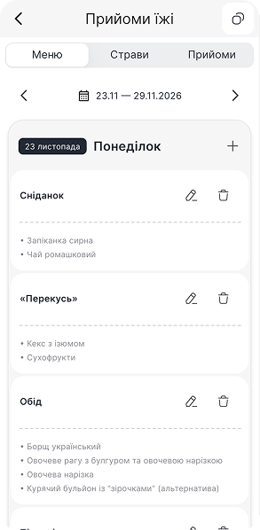

**Де та як відображається меню у батьків?**

У батьківському профілі меню розміщено на сторінці "Головна", внизу. 
Та виглядає наступним чином: 

**Чи відображається у вихователів?**

Так, у профілі вихователя меню також розміщене на сторінці "Головна", внизу. 

## Меню з вибором страв

:::warning Єдине на заклад
Меню з доступом батьків до обрання страв одне на весь заклад, без можливості внесення окремих меню для різних груп.
:::

До визначеного адміністратором часу батьки обирають потрібні страви із запропонованих по кожному прийому їжі, одразу фіксуючи вартість кожного прийому та зберігаючи вибір для контролю харчування дитини. На головній сторінці батьків відображається меню з їх вибором на поточний день, за бажанням вони можуть зробити вибір на інші дні тижня, натиснувши "Переглянути меню".

**Інструкція налаштування меню з вибором для батьків:**

Крок 1. Встановлюємо основні параметри системи та час закриття вибору. 

- Профіль закладу > Налаштування > Харчування > **"Меню з вибором страв"** > Вносимо значення поля **"Час завершення вибору"** > Вносимо значення поля **"Днів наперед"** > Зберегти.

:::tip Вибір закрито!
Для прикладу у закладі можливий вибір страв батьками до 15:00 попереднього дня. Тож в налашуваннях в полі "Час завершення вибору" вказуємо 15:00, а в полі "Днів наперед" ставимо 1. 
:::

Приклад: 

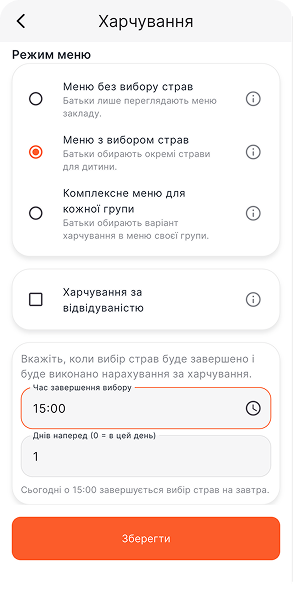

:::danger Нарахування в момент закриття вибору
Якщо у вас обраний час закриття вибору батьків, після якого вони вже не можуть редагувати та відміняти вибір, то нарахування за обрані страви чи комплексні меню буде **автоматично реалізовано саме в той час**! 

Адміністратору прийде пуш-повідомлення про успішне закриття та нарахування. 
:::

Крок 2. Вносимо прийоми їжі, страви та формуємо розклад меню на день.

- Профіль закладу > Харчування > **Прийоми** > "+" > Додаємо назву прийому іжі (наприклад, "Сніданок") > В полі "Ціна, грн" залишаємо 0, якщо не будемо нараховувати по прийомам їжі згідно відвідуваності > Порядковий номер присвоюється автоматично.
- Профіль закладу > Харчування > **Страви** > "+" > Додаємо назву страви (наприклад, "Сирники") > Заповнюємо іншу інформацію по страві: **вартість**, вага, калорійність, примітки про алергени чи детальний опис > Додати.
- Профіль закладу > Харчування > **Меню** > На дні тижня натискаємо "+" та додаємо прийоми з попередньо внесених в розділ "Прийоми" > Додати.
- Профіль закладу > Харчування > Меню > **День тижня** > "+" на прийомі їжі > Додаємо страви із списку > Зберегти.

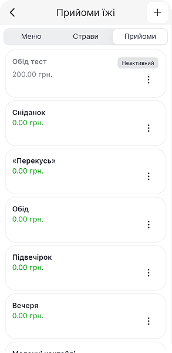 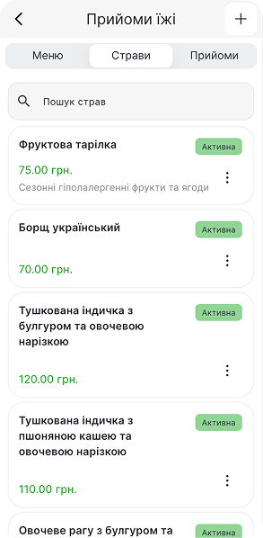 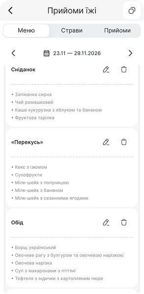 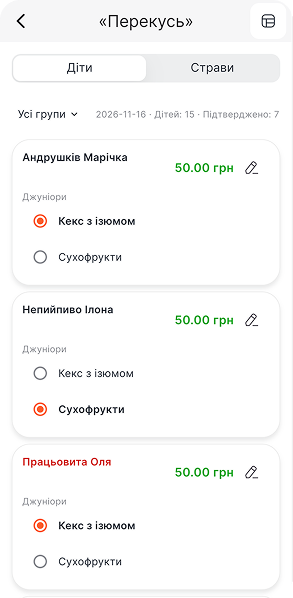 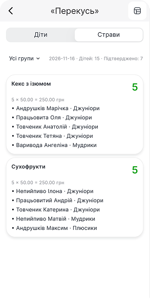 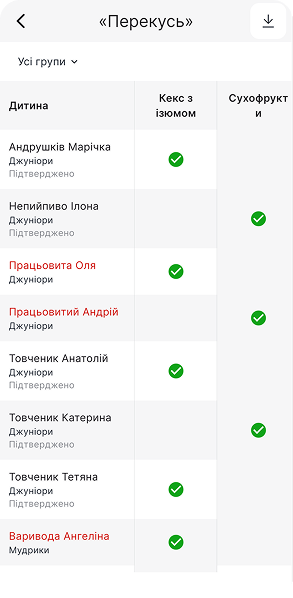 

**Де та як обирають страви батьки?**

У батьківському профілі меню розміщено на сторінці "Головна", внизу. При натисканні "Переглянути меню" відкривається список доступних днів, прийомів та страв для вибору:

 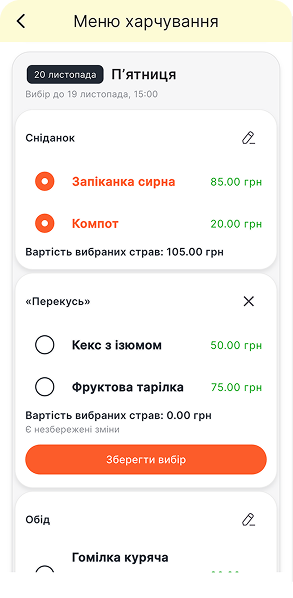

**Чи відображаються звіти з вибором батьків у вихователів?**

Так, у профілі вихователя меню також розміщене на сторінці "Головна", внизу, зі звітами та деталізацією вибору по кожній дитині. 

## Комплексне меню для кожної групи

:::warning Окремі меню груп (комплексні варіанти)
Тип меню з можливістю внесення окремих меню для кожної групи. 
:::

В даній комбінації налаштувань можна на один прийом їжі (наприклад, "Сніданок") додати комплексні варіанти: "Безглютеновий сніданок", "Основний сніданок" та "Без сніданку". Кожен комплекс має певний перелік страв з одною загальною вартістю комплексу. Батьки можуть обрати тільки 1 варіант.

**Інструкція налаштування комплексного меню для груп:**

Крок 1. Встановлюємо основні параметри системи. 

- Профіль закладу > Налаштування > Харчування > **"Комплексне меню для кожної групи"** > Зберегти.

:::tip Вибір закрито!
Для прикладу у закладі можливий вибір страв батьками до 15:00 попереднього дня. Тож в налашуваннях в полі "Час завершення вибору" вказуємо 15:00, а в полі "Днів наперед" ставимо 1. 
:::

Приклад: 

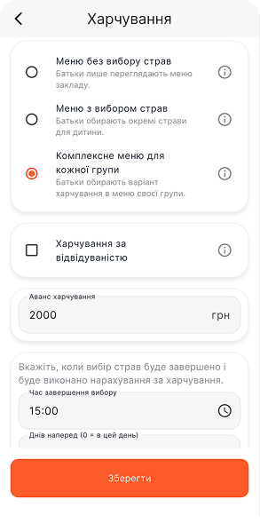

:::danger Нарахування в момент закриття вибору
Якщо у вас обраний час закриття вибору батьків, після якого вони вже не можуть редагувати та відміняти вибір, то нарахування за обрані страви чи комплексні меню буде **автоматично реалізовано саме в той час**! 

Адміністратору прийде пуш-повідомлення про успішне закриття та нарахування. 
:::

Крок 2. Вносимо прийоми їжі, страви.

- Профіль закладу > Харчування > **Прийоми** > "+" > Додаємо назву прийому іжі (наприклад, "Сніданок") > В полі "Ціна, грн" залишаємо 0, якщо не будемо нараховувати по прийомам їжі згідно відвідуваності > Порядковий номер присвоюється автоматично.
- Профіль закладу > Харчування > **Страви** > "+" > Додаємо назву страви (наприклад, "Сирники") > Заповнюємо іншу інформацію по страві: **вартість**, вага, калорійність, примітки про алергени чи детальний опис > Додати.

  

Крок 3. Приєднуємо прийоми їжі до розкладу, щоб вони автоматично відображалися в меню.

- Профіль закладу > **Групи** > Обираємо групу > **Розклад** > Редагуємо чи вносимо прийом їжі в розкладі, змінюючи тип "Інше" на "Харчування" > В полі "Обрати прийом їжі" обираємо зі списку шаблонних > Зберегти.

:::info Для всіх днів тижня
Так потрібно внести всі прийоми **з понеділка по пʼятницю**. Це налаштовується один раз, надалі система сама **автоматично оновлюватиме** даний розклад. 
:::

Детальніше процес в картинках:

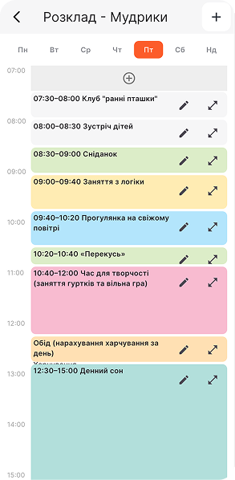 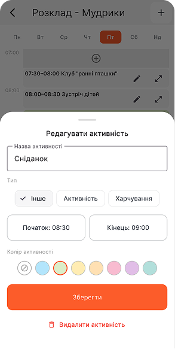 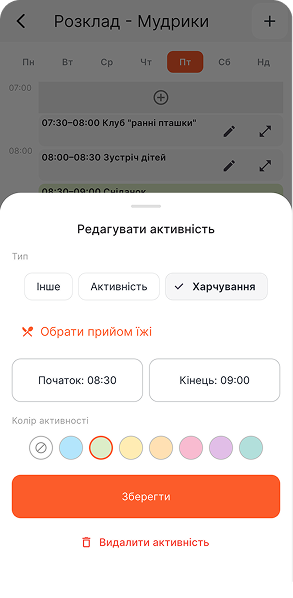 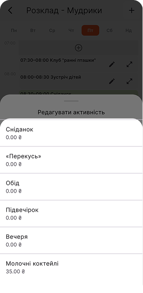 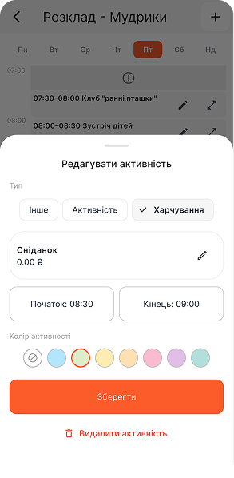  

Крок 4. Формуємо комплексні меню для груп.

- Профіль закладу > Харчування > **Меню** > Обираємо потрібну групу > Обираємо день > На прийомі їжі (відображається автоматично з розкладу) натискаємо "+" та додаємо назву комплексу (наприклад, "Основний сніданок", "Безглютеновий сніданок" чи "Їмо вдома", де активуємо опцію "Без харчування" тощо) > На створеному комплексі натискаємо "..." та "Додати страву" > Обираємо страви комплексу > Зберегти.

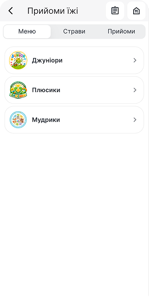 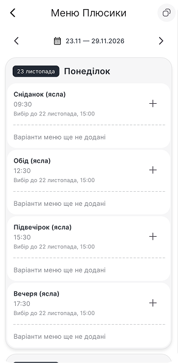 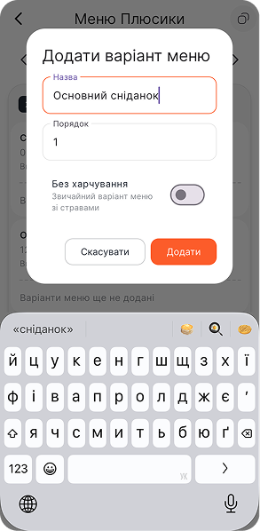 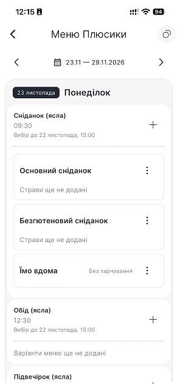 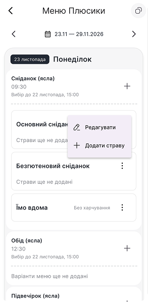 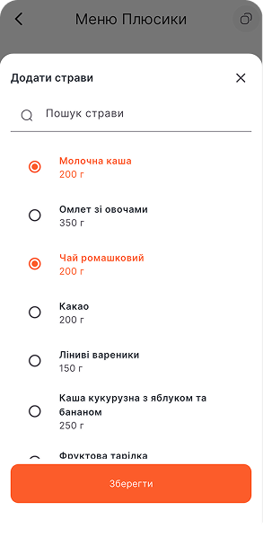 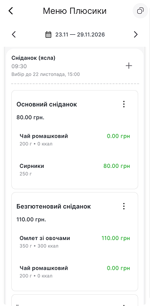 

**Де та як обирають комплексні меню батьки?**

У батьківському профілі меню розміщено на сторінці "Головна", внизу. При натисканні "Переглянути меню" відкривається список доступних днів, прийомів та комплексів для вибору.

**Чи відображаються звіти з вибором батьків у вихователів?**

Так, у профілі вихователя меню також розміщене на сторінці "Головна", внизу, зі звітами та деталізацією вибору по кожній дитині. 

## Копіювання меню

- Профіль закладу > Харчування > Іконка **"Копіювати"** у верхньому правому куті > Обираємо "Тиждень-зразок" чи "Дата джерела" (інформація, яку будемо копіювати) > Обираємо першу дату періоду, в який будемо копіювати, чи "Дата призначення" > Обираємо кінцеву дату періоду, в який будемо копіювати > Активуємо кнопку "Замінити наявні меню" (якщо вже було частково внесено дані) > Копіювати.

В картинках процес показано нижче:

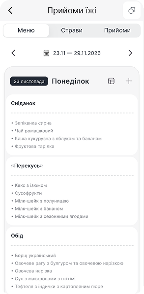 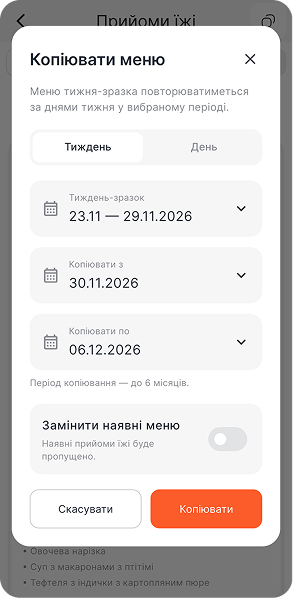 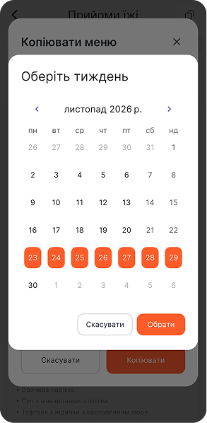 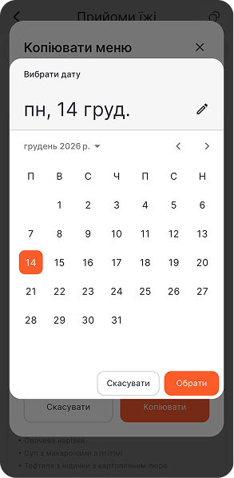 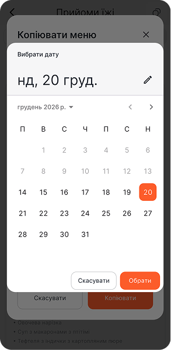 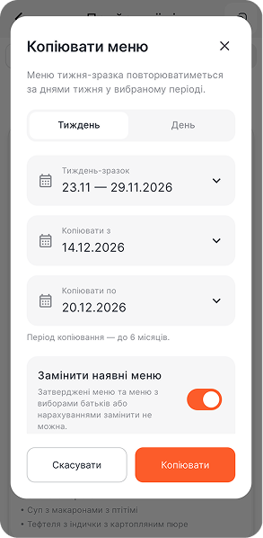

## Нарахування харчування згідно відвідуваності

Дана опція розділу "Харчування" дозволяє автоматизувати нарахування фіксованих вартостей за прийом їжі чи за день згідно присутності дитини. Табелювання (відмітки присутності) може здіснювати вихователь групи та адміністратор. 

**Інструкція налаштування автоматичних нарахувань по харчуванню:**

Крок 1. Встановлюємо основні параметри системи. 

- Профіль закладу > Налаштування > Харчування > Ставимо галочку біля опції "**Харчування за відвідуваністю**" > Зберегти.

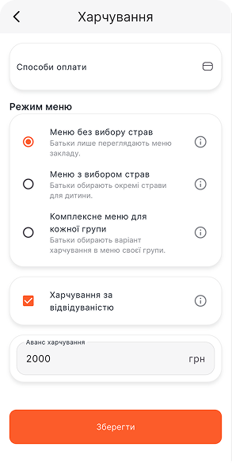

:::tip З МЕНЮ ТА БЕЗ
Даний розділ нарахування та обліку згідно відвідуваності може використовуватися **з будь-яким типом меню**, **і навіть без** внесення меню.
:::

Крок 2. Приєднуємо прийоми їжі до розкладу, щоб вони автоматично відображалися в розділі харчування списками для відміток присутності.

- Профіль закладу > **Групи** > Обираємо групу > **Розклад** > Редагуємо чи вносимо прийом їжі в розкладі, змінюючи тип "Інше" на "Харчування" > В полі "Обрати прийом їжі" обираємо зі списку шаблонних > Зберегти.

:::info Для всіх днів тижня
Так потрібно внести всі прийоми **з понеділка по пʼятницю**. Це налаштовується один раз, надалі система сама автоматично оновлюватиме даний розклад. 
:::

Детальніше процес в картинках:

      

Крок 3. Перевіряємо списки табелювання. 

- Профіль закладу > Харчування > Обираємо зверху потрібну групу > Прийом їжі > Ставимо галочки присутності.

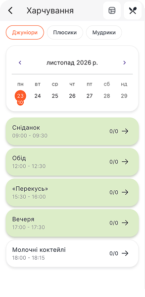 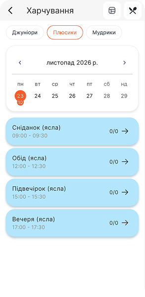 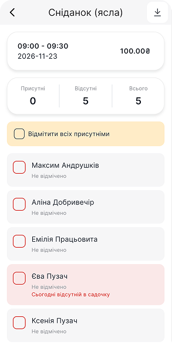 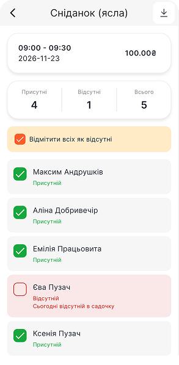

:::info Нарахування за день
Якщо у вас нарахування харчування відбувається один раз на день, то приєднуємо до розкладу тільки один прийом їжі, який буде нараховувати суму за день. Приклад нижче.
:::

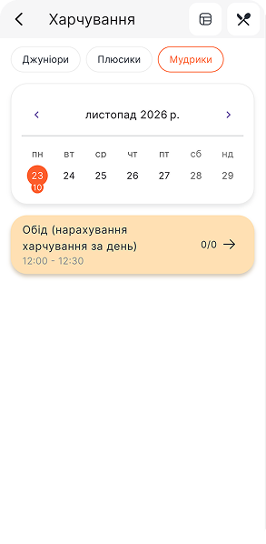 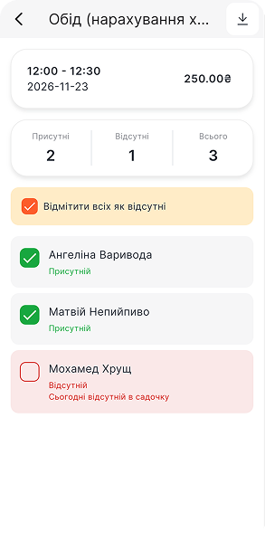

:::warning Автоматичні нарахування
Кожна галочка присутності означає нарахування за харчування відповідного прийому їжі чи за день в баланс дитини. Баланс можна перевірити в профілі дитини (розділ "Діти") чи в звіті харчування.
:::

Крок 4. Перевіряємо відображення списків табелювання у вихователів груп. 

У вихователів список для відміток присутності по харчуванню розміщений в розділі "Календар", у верхньому правому куті під іконкою "столових приборів":

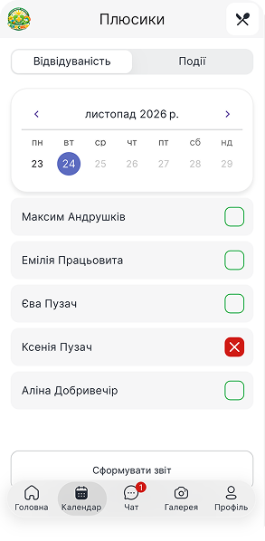 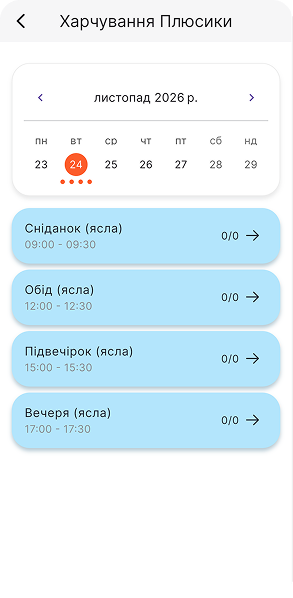 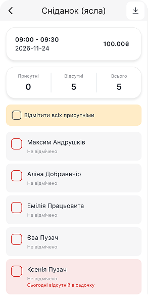 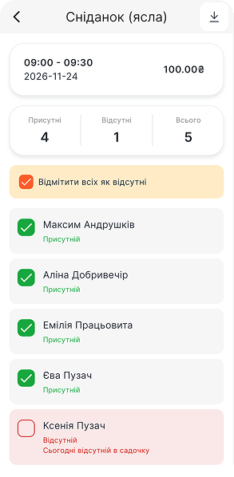

## Звіти по харчуванню

:::tip Звіти
Всі звіти розділу харчування розміщені під іконкою звітів. 
Виглядає вона так:

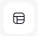
:::

Наприклад, звіт розділу "Харчування за відвідуваністю":

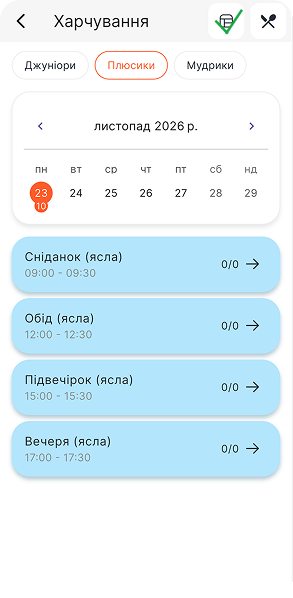 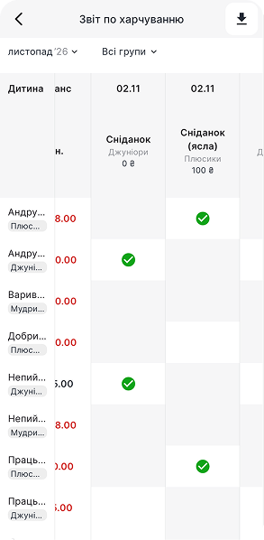

